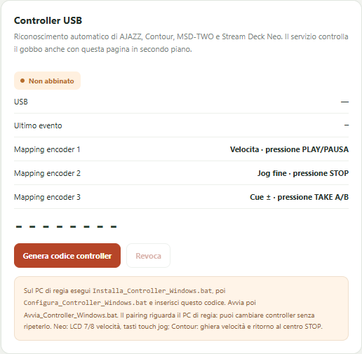

# AKP03E — historical 0.8 guide

For current automatic detection and interchangeable controllers use [CONTROLLERS.md](CONTROLLERS.md). This guide describes the original direct HID integration (`0300:3002`), implemented from public protocol references. No physical AKP03E was tested here.

LCD 1–6: PLAY/PAUSE, previous cue, next cue, blackout, TOP, TAKE A/B. Icons reflect play, blackout and target readiness (N/R when unavailable). Encoder 0: speed ±0.015 vh/s per step, press PLAY/PAUSE; encoder 1: jog ±0.08 vh, press STOP; encoder 2: cue −/+, press TAKE. Side keys 7–9: clear message, STOP, TAKE. Events are debounced; USB disconnection triggers reconnection attempts.

## Original Windows setup

1. Apply 0.8 over 0.7; restart `Avvia_Server_LAN_Windows.bat`.
2. Generate a controller code in Prompt's AKP03E panel.
3. Run `Installa_Controller_AKP03E_Windows.bat`, connect USB-C and run `Test_Controller_AKP03E_Windows.bat` (12-second event display).
4. Pair with `Configura_Controller_AKP03E_Windows.bat`; start `Avvia_Controller_AKP03E_Windows.bat`.

Original dependency: Python 3.11+, `hidapi==0.15.0`. Current launchers forward to the unified service. Close vendor software during direct access. The private scoped token in `data/akp03e_controller.json` cannot administer the server or edit scripts. Codes are one-use, eight digits, valid ten minutes; use trusted-LAN HTTP only.

LCDs use pre-generated 60×60 JPEGs. `iconRotation` accepts 0/90/180/270; default 270 follows a hardware-tested external reference, not a test performed here. Verify your firmware's orientation.

## Endpoints and TAKE

```json
{
  "servers": ["http://192.168.10.10:8787"],
  "oscTargets": ["192.168.10.11:9000", "192.168.10.12:9000"]
}
```

Addresses are examples. `servers` lists HTTP endpoints; `oscTargets` enables optional UDP fallback. For current per-Core tokens, ambiguous-result handling and fallback restrictions, follow CONTROLLERS.md. Multiple endpoints do not create an HA cluster. Players retain local scrolling if server/controller access fails.

```text
/carisma/prompt/take/primary
/carisma/prompt/take/backup
/carisma/prompt/take "PRIMARY"
```

TAKE updates `activeRole`, console and LCD status only; it does not switch HDMI. PRIMARY/BACKUP render in parallel. References below are protocol cross-checks, not bundled runtime components.

## References

- https://github.com/Aiacos/ajazz-control-center/blob/develop/docs/protocols/streamdeck/akp03.md
- https://github.com/tomekceszke/ajazz-akp03e
- https://github.com/mishamyrt/ajazz-sdk
- https://pypi.org/project/hidapi/

## Current controller panel

Legacy AKP03E launchers now use the unified service. Its pairing/status panel is shown below in the unpaired state; no hardware test is implied.



[Current controller guide](CONTROLLERS.md) · [Other pages](docs/SCREENSHOTS.md).
