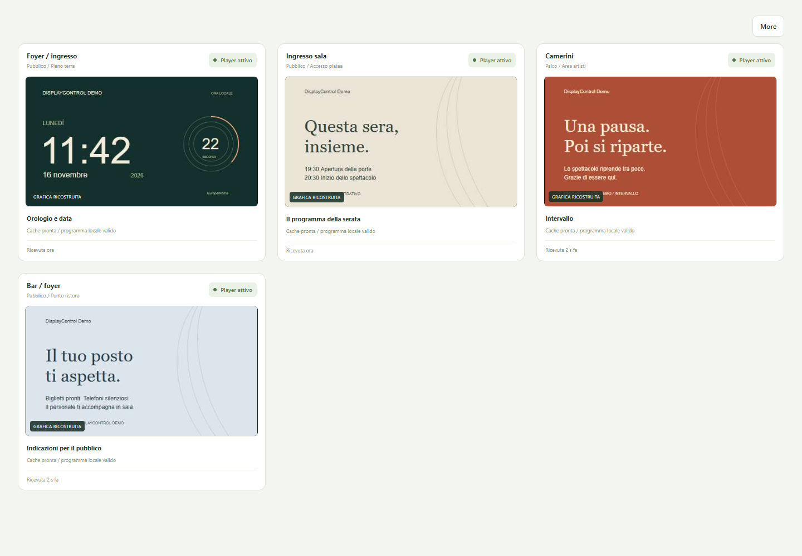
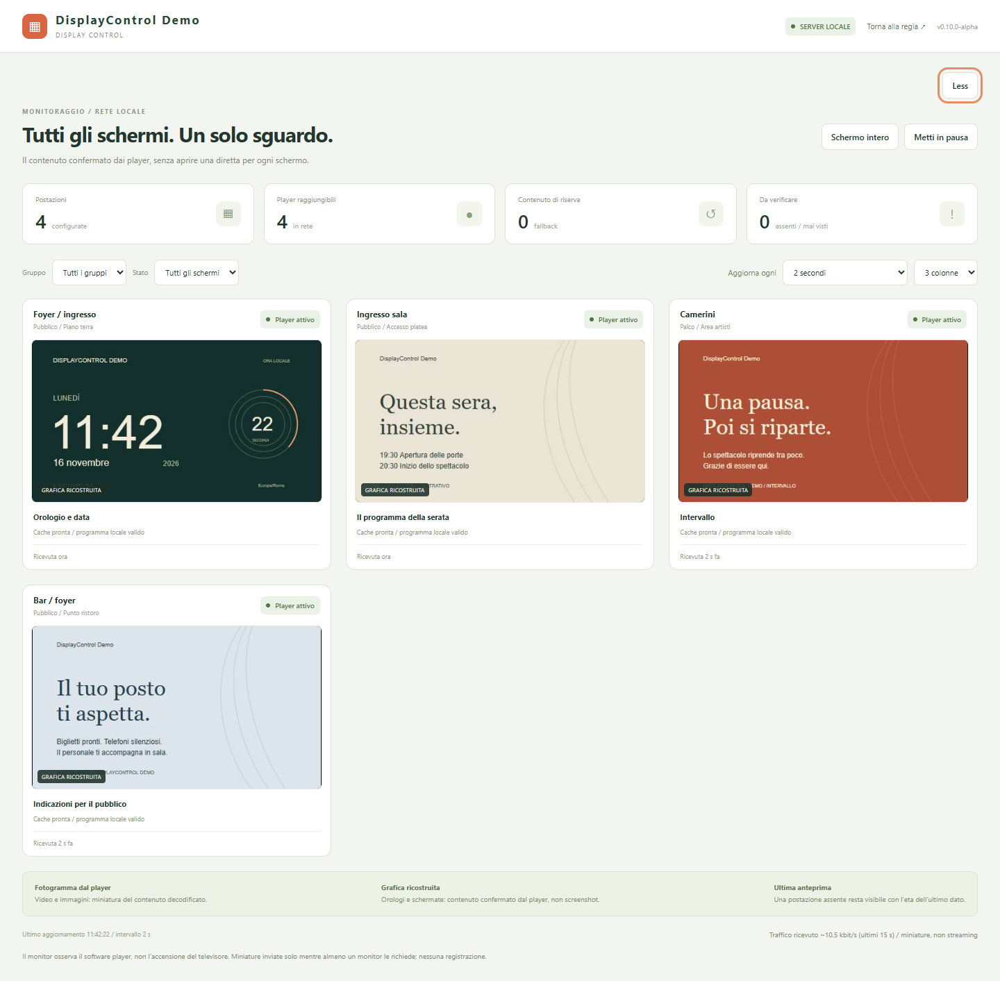

# Screen monitor — historical 0.5.2 guide

Includes 0.5.1 buffering changes. Back up and stop the server, then extract `Carisma_Aggiornamento_Monitor_Latenza_v0.5.2.zip` beside `server.py`. Restart `Avvia_Server_LAN_Windows.bat`; reload console and every PC player. Retain browser data/pairing. Earlier-than-0.5 installations need the complete package. Data, local configuration, installed binaries and firewall are unchanged.

Open `/monitor.html` on the server address; authenticate with `data/access.key`, not a pairing code. Old open player pages must reload before producing thumbnails.

## Display and collection

Monitor shows all screens, group/status filters, 2/3/4 columns, fullscreen, last content, preview age, fallback/offline status and player queue. Refresh targets are 1/2/5 s (default 2), subject to HTTP/browser delays. Initial preview also waits for a player contact, normally every 2.5 s. After about 13 s without contact, a player is unreachable; its old image stays visibly stale. Unseen players get no invented preview.

Video/live previews are decoded player frames captured with Canvas; images are resized copies. Clocks/graphics are labeled reconstructions, not pixel-exact DOM screenshots. Black output has a declared black thumbnail. These are player-software reports, not proof of an active TV/HDMI cable. Cross-origin media may prevent capture; playback continues with preview unavailable. Monitoring starts no additional NDI receiver or encoder.

JPEGs are at most 480×270, quality 0.58, 64 KiB. Uploads occur only while an administrator monitor requests them. Hide, close or pause releases demand; abandoned leases expire in 12–15 s. Multiple monitors use the shortest active interval. Filters avoid downloading hidden cards, but players still upload while collection is requested.

Only the latest thumbnail per player lives in RAM; restart, revocation or re-pairing removes it. Unchanged JPEGs are not fetched again. The 15 s traffic counter includes received JPEG/JSON bodies, excluding headers, NDI and uploads; uploads have base64 overhead. Example: twenty 10 kB images every 5 s give about 40 kB/s before metadata, not a measured deployment limit. Four local fixture JPEGs measured about 7.3–8.4 kB.

## Buffering and limits

Responsive mode targets 0.75 s queue, 0.5 s segments (0.533 s at 15 fps; 0.520 s at 25 fps), aligned keyframes and 100 ms polling. **Torna alla diretta** catches up only to available gateway video. If configured as stable, change only `CARISMA_LIVE_MODE` to `responsive`. Stable alternative:

```bat
set "CARISMA_LIVE_MODE=stable"
```

Restart/reload after changes. The historical stable/responsive mean queues, 1.807/0.632 s, came from local FFmpeg/Chromium tests, not real NDI latency or a new monitor measurement. See [latency guide](LEGGIMI_LATENZA_v0.5.1.md).

Monitoring requires LAN access and administrator credentials; each player can upload only its own image. Internet is unnecessary after setup. An isolated player may keep playing while appearing unreachable. Plain LAN HTTP cold-start offline remains unguaranteed; use a trusted LAN and protect potentially private previews.

Android sources have manifest 0.5.2-alpha/versionCode 52, but no APK was built here. The builder's historical APK filename remains 0.5-alpha. Installed apps require rebuild/reinstall; Ctrl+F5 updates PC browser pages only. See [QA_MONITOR_v0.5.2.md](QA_MONITOR_v0.5.2.md).

## References

- https://developer.mozilla.org/en-US/docs/Web/API/HTMLCanvasElement/toBlob
- https://developer.mozilla.org/en-US/docs/Web/API/Media_Capture_and_Streams_API/Taking_still_photos
- https://developer.mozilla.org/en-US/docs/Web/API/Page_Visibility_API
- https://ffmpeg.org/ffmpeg-formats.html

## Current monitor interface

These screenshots show the updated interface, not the historical 0.5.2 test run. Default: only the matrix and **More**. Click **More** for filters, refresh/column controls, statistics, pause/fullscreen and help; **Less** returns to the matrix. Reload always starts collapsed. Monitoring continues while controls are hidden; failures and stale previews remain visible.





Demonstration browser players only. [All main pages](docs/SCREENSHOTS.md).
