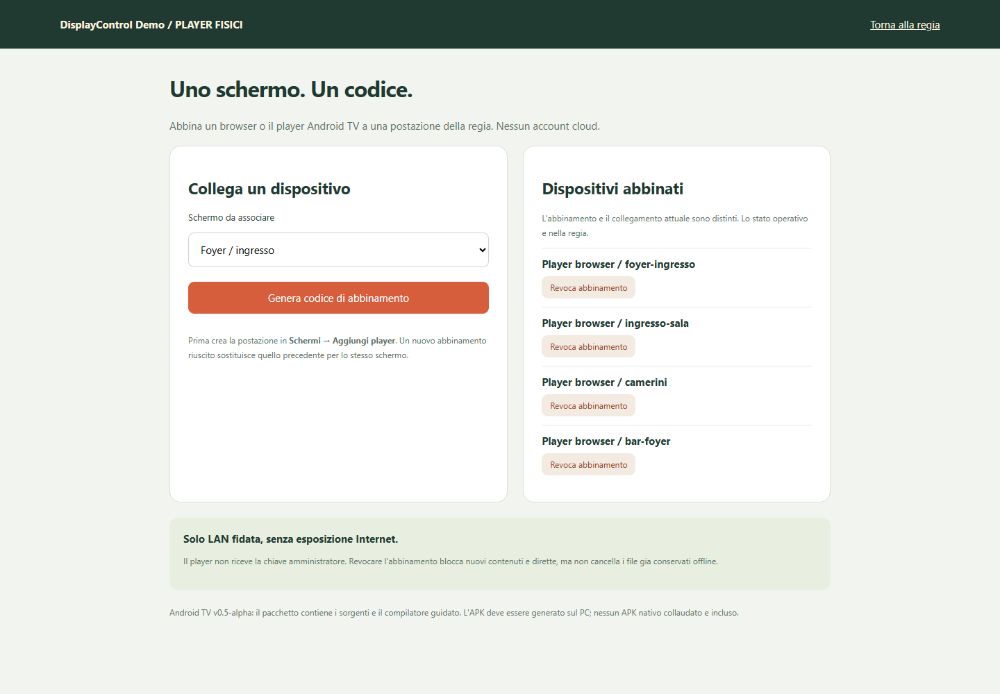
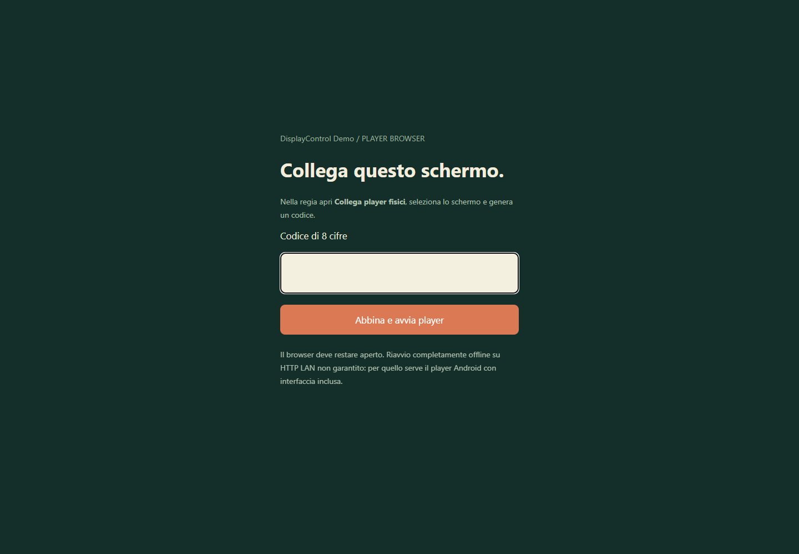

# Physical-player workflow — historical 0.5 guide

Adds LAN startup, one-use pairing and scoped player credentials. Browser/API/FFmpeg tests used the limits in [QA_PLAYER_FISICI_v0.5.md](QA_PLAYER_FISICI_v0.5.md). **Android TV sources/build helpers are included; no compiled/tested APK or reached Chromecast G454V is claimed.** Firmware, bootloader and Google launcher remain unchanged.

## Upgrade and LAN

Stop the server and back up privately. Merge patch files beside `server.py`; retain `data/`, `bin/ffmpeg`, `.setup/` and `Config_Locale.bat`. New SQLite tables are added on startup. For a full installation, transfer those private folders/configuration while stopped.

Run `Avvia_Server_LAN_Windows.bat` for TCP 8787 on all interfaces; normal startup stays on loopback. Keep the server awake. Read its LAN IPv4 with `ipconfig`, then open `http://SERVER-IP:8787` from another device. Check address, VLAN/client isolation and private-network firewall rules if unavailable; do not forward the port to the Internet.

Optional administrator firewall rule, only on the correct trusted network:

```powershell
New-NetFirewallRule -DisplayName "Carisma Display LAN" -Direction Inbound -Action Allow -Protocol TCP -LocalPort 8787 -Profile Private -RemoteAddress LocalSubnet
```

## Pair a browser

Create a screen, assign a local clock and fallback, then open **Collega player fisici**. Use the administrator key from `data/access.key` to generate an eight-digit code (one use, ten minutes). On the player open `/connect.html` at the server address and enter it. Change content and confirm heartbeat. Start with small files and conservative cache, e.g. 150 MB.

A new code invalidates old codes for that screen; completed re-pairing replaces its device. Give independent TVs separate screen identities. Player tokens cannot administer the console or access unassigned media/live sources. Revocation cannot erase files already downloaded to an offline device. HTTP is for a trusted private LAN only.

## Build and install Android TV

`Compila_Player_Android_Windows.bat` needs JDK 17+ and Android SDK. It can propose Microsoft OpenJDK 21 via winget with user consent. Missing Google command-line tools are downloaded with a pinned SHA-256; the user accepts SDK licenses. Targets: API 35, Build Tools 35.0.0, Platform Tools. Tools: `aapt2`, `javac`, `d8`, `zipalign`, `apksigner`.

Only a successful build produces:

```text
android-build/Carisma_Player_TV_v0.5-alpha.apk
android-build/SHA256.txt
```

Signing keys/passwords are generated locally in `data/android-signing/`; keep them private for future updates. Never bypass failed hash/signature checks. No complete Android build was run in the original environment.

Run `Installa_Player_Chromecast_Windows.bat` and select the exact authorized device. Enable developer/debug options on the TV: wireless-debug pairing and connection may use different ports; USB needs suitable power/cabling; port 5555 is not assumed. No root, exploit, reset or launcher replacement is used.

Open Carisma Player, enter the server's private IPv4 HTTP address and a new code. This version accepts private IPv4, not DNS/public addresses. Back opens audio, diagnostics, reload and pairing. Disable debugging after tests; playback does not need ADB. App autostart after power-on is not implemented.

The bundled shell executes local HTML through an intercepted HTTPS origin; the server supplies JSON/media/fMP4. IndexedDB stores synchronized content. NDI decoding stays on the server, not Chromecast. App code calls no Google Play service; underlying Google TV behavior is unchanged.

## On-site acceptance

1. Second LAN browser: clock, image, content change and pairing.
2. One Chromecast: clock/image, then local video, server test generator and real NDI at 360p/15 fps.
3. Check remote control, audio/AV delay, codecs/WebView, cache readiness, CPU/RAM/temperature.
4. Disconnect/reconnect LAN; reopen offline after synchronization; test power loss and extended operation before adding players.

Open players can retain programs through server loss; live needs LAN/source/gateway. Offline app reopening depends on persistent cache and needs device testing. Plain LAN HTTP browser cold-start is not guaranteed. Android boot, HDMI, power-loss recovery and 24/7 operation remain unverified. Do not infer native Android success from desktop Java policy tests.

## References

- https://developer.android.com/training/tv/get-started/create
- https://developer.android.com/develop/ui/views/layout/webapps/load-local-content
- https://developer.android.com/tools/adb
- https://developer.android.com/tools/sdkmanager
- https://developer.android.com/studio
- https://learn.microsoft.com/en-us/windows/dev-environment/java
- https://learn.microsoft.com/en-us/powershell/module/netsecurity/new-netfirewallrule

## Current browser pairing screens

These screenshots use temporary browser players, not Chromecast or physical panels. No active pairing code is displayed.





[Paired output and other pages](docs/SCREENSHOTS.md).
