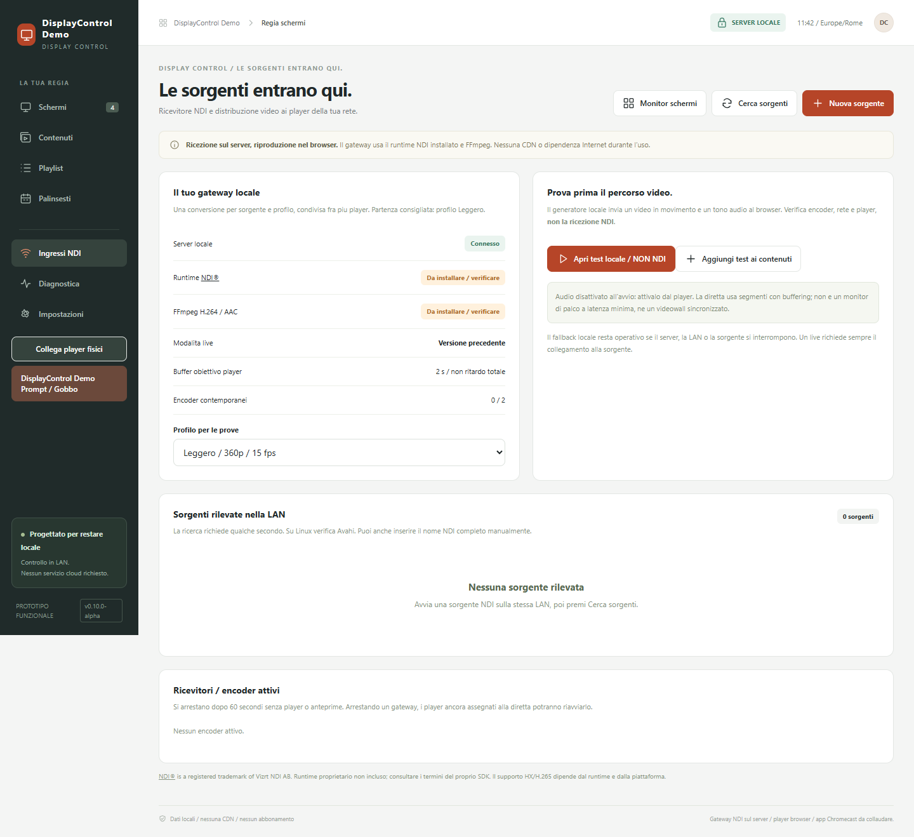

# Windows dependencies — historical 0.4.1 guide

Selective repair addresses missing FFmpeg while preserving working Python/NDI (the reported installation had Python 3.14.7 x64 and NDI 6.2.1.0).

Stop the server, back up the project and extract the patch beside `server.py`. Run `Verifica_NDI_Windows.bat`; after **DIPENDENZE: OK**, run `Avvia_Windows.bat`. Test the local **NON NDI** generator, then a real LAN source. Keep `data/` and `Config_Locale.bat`; neither is rewritten.

| Entry point | Action |
|---|---|
| `Verifica_NDI_Windows.bat` | Check, repair missing/unusable dependencies, recheck |
| `Solo_Verifica_NDI_Windows.bat` | Diagnosis only; temporary codec video is deleted |
| `Avvia_Windows.bat` | Use saved paths and start; bootstrap Python if absent, without installing FFmpeg/NDI |
| `python diagnose_ndi.py --smoke-test` | Diagnosis only |

## Repair policy

- **FFmpeg:** reuse libx264/AAC-capable builds passing the smoke test. Otherwise fetch gyan.dev x64 release essentials, verify SHA-256, safely extract and test in staging. Install under `bin/ffmpeg/`, retaining licenses and the previous build in `bin/ffmpeg.backup-...`. Cache downloads/checksums in `.setup/downloads/`.
- **Python:** find compatible 64-bit Python 3.9+ via saved paths, PATH, launcher and registry. Only if absent, fetch the pinned Python 3.14.10 x64 installer (reference release 2026-10-25), verify hash/signature and install per user. Working Python is not upgraded; global PATH/launcher are unchanged. Server setup needs no pip/Chocolatey/WinGet.
- **NDI:** preserve a loadable runtime. If none is available, fetch `https://ndi.link/NDIRedistV6`, verify Authenticode/publisher and open the official installer. The user reviews the license and any UAC request. Cancellation, invalid signatures or failed final checks report failure. Zero discovered sources is a warning, not a reason to reinstall.

No automatic firewall, antivirus, global execution-policy or restart changes. Corporate policy failures require administrator review, not disabled protections. Initial downloads need Internet or a prepared verified cache; normal local operation does not. Signature validation may require current Windows trust information.

## Generated files and recovery

| Path | Purpose |
|---|---|
| `.setup/python-path.txt` | Selected interpreter |
| `.setup/dependencies.json` | Verified dependency paths |
| `.setup/install.log` | Rotated repair log |
| `.setup/install.lock` | OS-released repair lock |
| `.setup/downloads/` | Downloads/checksums |
| `bin/ffmpeg/` | Full local distribution and licenses |

Project paths are relative; external paths stay absolute. Saved paths take precedence only for project launchers. To return to manual configuration, stop the server, rename `.setup/dependencies.json` and set real paths in `Config_Locale.bat`. Moved installations are rechecked.

Interrupted downloads remove partial files and preserve the previous build. Hash/signature failures block installation. Use a writable user folder; FFmpeg setup need not run as administrator. Runtime-load errors retain DLL details for diagnosis. No-source warnings require transmitter/subnet/firewall checks.

## Original verification boundary

The 0.4.1 report used Linux tests and real FFmpeg conversion, not native Windows PowerShell, Authenticode, UAC or installer execution. Those paths and physical NDI still required on-site checks. See [QA_REPORT_v0.4.1.md](QA_REPORT_v0.4.1.md); this historical boundary is distinct from later Windows release tests. Download references were consulted 2026-10-29; hashes/signatures are checked again during setup.

## References

- https://ffmpeg.org/download.html
- https://www.gyan.dev/ffmpeg/builds/
- https://www.gyan.dev/ffmpeg/builds/ffmpeg-release-essentials.zip.sha256
- https://www.python.org/downloads/release/python-31410/
- https://docs.python.org/3.14/using/windows.html
- https://docs.ndi.video/all/developing-with-ndi/sdk/dynamic-loading-of-ndi-libraries
- https://docs.ndi.video/all/developing-with-ndi/sdk/software-distribution

## Interface reference

After setup, check dependencies in **Ingressi NDI**:

This is a current browser capture, not a historical Windows-installer test. [All main pages](docs/SCREENSHOTS.md).
