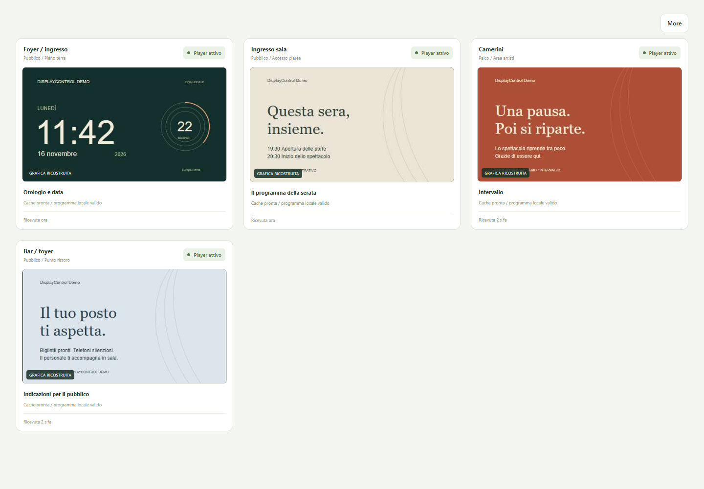
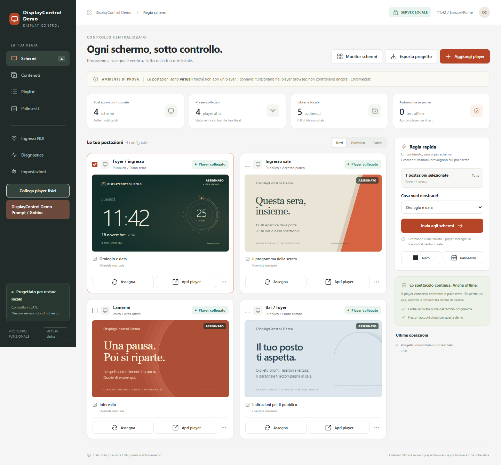

# DisplayControl

Local signage and teleprompter control, derived from Carisma Display Control. **0.10.0-alpha**.

Web console, browser players, TXT/DOCX scripts, cues, OSC and interchangeable USB controllers. The optional NDI gateway converts server-side NDI to browser video with FFmpeg.

## Start

Python 3.9+; the server uses only the standard library.

```sh
python server.py
```

Open the printed address and use the locally generated key. On macOS/Linux use `python3` if required. Local data is created in `data/`, excluded from Git.

| Page | Path |
|---|---|
| Console | `/` |
| Prompt control / player | `/prompt.html` / `/prompt_player.html` |
| Screen monitor | `/monitor.html` |
| Signage pairing | `/players.html` |

For LAN access use `python server.py --host 0.0.0.0`. HTTP is intended for a trusted LAN; do not expose the server to the Internet. Downloading the project from home requires no access to the live server.

## Organization and Prompt

In Settings, enter the organization name and upload a PNG, JPEG or WebP logo. The app resizes it locally and suggests a color theme for optional application. A small header logo leaves scripts, show messages and video outputs unobstructed. Internal identifiers, filenames, credentials and `/carisma/...` OSC paths remain compatible.

Prompt preview and players share `prompt_shared.js`: a fixed 1280×720 page, identical typography and a monotonic timeline. Windows scale without reflow; `offsetVh` and rate refer to the virtual page. Command sequencing rejects stale replies; scrolling continues through server outages. Restart the server and reload every Prompt page after updating. Do not mix 0.8 and 0.9+ pages; check font availability across operating systems.

## Optional components

- USB: install, pair once, then start the background service. Windows: `Installa_Controller_Windows.bat`, `Configura_Controller_Windows.bat`, `Avvia_Controller_Windows.bat`. macOS/Linux: `sh Installa_Controller_Linux_Mac.sh`, then `sh Avvia_Controller_Linux_Mac.sh --setup` and `sh Avvia_Controller_Linux_Mac.sh`.
- AJAZZ AKP03E, Contour ShuttleXpress/PRO v2, Mars Gaming MSD-TWO and Stream Deck Neo are detected automatically. Swap without pairing again; Prompt may be closed. See [CONTROLLERS.md](CONTROLLERS.md).
- The controller service needs Python 3.11+, hidapi and Pillow, installed in `.controller-venv/`. Legacy AKP03E launchers use the same service.
- Each Core needs its own token. Pairing multiple Cores does not replicate scripts, databases or state. OSC fallback is unacknowledged; ambiguous HTTP results do not replay relative commands, and authentication refusals do not fall back to OSC.
- NDI requires separate FFmpeg and official NDI runtime installations. See [NDI setup](LEGGIMI_NDI.md) and [Windows setup](LEGGIMI_SETUP_WINDOWS_v0.4.1.md). Vendor binaries are excluded.
- Android TV sources are included; no tested APK is supplied.

## Verification

```sh
python -m unittest discover -s tests -v
node tests/test_live_policy.js
node tests/test_branding.js
node tests/test_prompt_timeline.js
```

Encoding and simulated ABI tests need FFmpeg/ffprobe and a C compiler; check the summary for skipped tests. The 0.10 release passed **151 Python tests, no failures/errors/skips**, and three JavaScript suites. Controller tests use synthetic HID reports and real loopback HTTP. Historical 0.9 browser checks remain labeled separately. See [TEST_REPORT.md](TEST_REPORT.md).

**No physical controllers, real NDI source, Raspberry/Chromecast, QLab, HDMI switching or HA cluster were validated.** TAKE changes the logical role only. This is an alpha release.

## Download and publication

Use GitHub **Code → Download ZIP**, a release, or `git clone`. To transfer your installation, back up `data/` privately; it contains credentials, scripts and media and must stay outside the public repository.

Public sources exclude operational data, databases, keys, local configuration, historical raw logs, caches, vendor binaries and signing material. Test credentials are synthetic. No project license has been selected; publication does not grant a new license. Dependencies retain their own terms; see [SOURCES.md](SOURCES.md).

## Interface preview

Default monitor: panel matrix with **More** for controls. **Less** collapses them; reloading restores the matrix. Polling and visible error/stale states continue in either view.





See the [illustrated interface guide](docs/SCREENSHOTS.md) for Prompt, settings/logo, content, schedules, pairing and NDI. Captures use synthetic content and browser players; they do not certify physical hardware.
