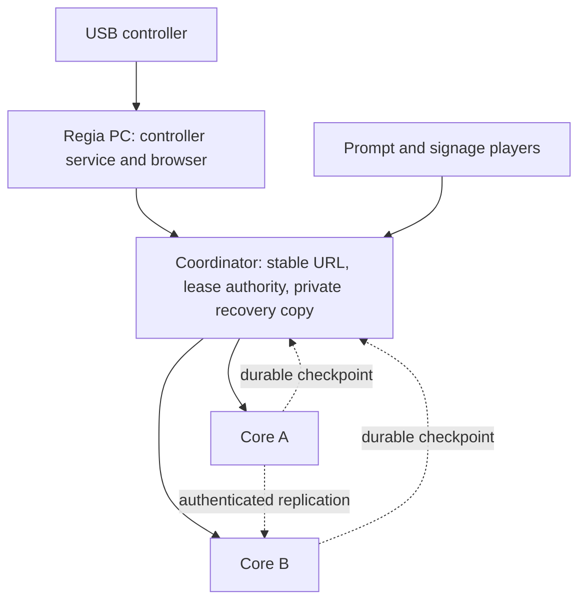

# Two Cores and a coordinator

The regia PC runs `coordinator.py`: a stable HTTP entry point, single lease authority and private recovery store. Core A and Core B run `server.py`. Use three separate machines for real fault isolation; the local process tests do not certify that hardware.



## Provision

Back up existing data privately. Keep the original production installation stopped while preparing a replacement. Choose real LAN addresses; these are examples:

```sh
python setup_cluster.py --core-a http://192.168.10.11:8787 --core-b http://192.168.10.12:8787 --coordinator http://192.168.10.10:8787
```

The generator writes private bundles under `data/cluster-setup/`, each with `cluster.json` and `START.txt`. It refuses to overwrite existing bundles. Copy only the relevant JSON into each machine's `data/cluster.json`; distribute the code separately from GitHub. These files contain the shared cluster key and must never enter the public repository.

On Core A and Core B respectively:

```sh
python server.py --host 0.0.0.0 --port 8787 --cluster-config data/cluster.json --prompt-osc-port 0
```

On the regia/coordinator PC:

```sh
python coordinator.py --host 0.0.0.0 --port 8787 --config data/cluster.json
```

Use Python 3.9+ (`python3` where appropriate); controller service still requires 3.11+. Set up required FFmpeg/NDI runtimes on both Cores before using live inputs. Start both Cores and the coordinator; Core A is the first bootstrap writer. Preserve existing show data on Core A. Core B receives the authoritative copy, so do not leave unique work only on it.

Open **the coordinator URL** on every console and player, and configure the USB service against that URL. Use Core A's administrator key. Its scoped player/controller identities are copied privately so failover needs no new pairing. Existing players using a direct Core address must be moved to the coordinator and paired for that origin; browser storage is origin-specific.

The SHOW PACKAGE page reports active Core, confirmed checkpoint and replica reachability/alignment. Wait for both nodes to align before acceptance tests.

## Guarantees and boundaries

- The coordinator grants a six-second lease to one Core. A Core uses a conservative local deadline and checks its lease again before committing SQLite changes. A standby or expired writer rejects changes, including OSC-driven changes.
- A successful mutation response requires a checkpoint saved durably on the coordinator. The other Core receives copies through a bounded/coalesced worker. A missing Core does not prevent the surviving Core from writing while the coordinator remains available.
- A stale Core cannot be promoted until it restores the latest confirmed checkpoint. The coordinator retains database/identity checkpoints and content-addressed media for recovery. Prompt runtime, scripts, media, pairings, revocations and controller request deduplication travel in this **private** path.
- Failure of the active Core leads to promotion after its lease expires and a current reserve is available. In-flight commands may have ambiguous outcomes; the proxy does not automatically replay POST/PUT. Controller request IDs remain deduplicated after failover. Relative OSC commands have no delivery acknowledgement.
- Controller deduplication retains up to 16,384 recent request IDs, with a maximum age of 24 hours. Older IDs must not be resubmitted as new retries. Checkpoint snapshots are compacted; unchanged content-addressed media are not rehashed/transferred on every command.
- The returning old Core becomes a replica; there is no automatic failback to Core A. A restarted process cannot inherit another process's old grant. A restarted coordinator waits out possible old grants before choosing a writer.
- The coordinator is a required single authority. If it fails or is partitioned, new commands stop after lease expiry; synchronized open players retain local playback. This is automatic **Core** failover, not redundant coordination. Use appropriate power/UPS and protect the regia PC.
- NDI receiver/FFmpeg pipelines restart on the newly active Core when readers request them. Live video may show fallback during reconnection; this is not frame-continuous NDI redundancy or HDMI switching.

Use one trusted LAN, stable addresses and synchronized clocks. HTTP does not encrypt cluster secrets or checkpoints; use a locally managed TLS layer if the network requires it. Do not publish Core/coordinator ports on the Internet. Never run two independent coordinators for the same pair.

Protect `data/coordinator/`, Core data folders and configuration: HA copies deliberately contain credentials. SHOW PACKAGE excludes them. Local previous-show ZIPs, local station/controller configuration, OS settings and installed dependencies are not replicated machine images.

## Acceptance tests

1. Verify content/cues/media and token scopes through the coordinator; ensure both Cores report aligned.
2. Start Prompt, then stop the active Core. Observe local scrolling, promotion, control recovery and retained pairing.
3. Change a cue/message on the surviving Core. Restart the old Core; verify it catches up without taking over.
4. Stop the coordinator; confirm neither Core accepts new commands after lease expiry. Restart it and check recovery.
5. Repeat with actual network cables, power interruption, NDI sources and controller hardware. Record recovery time and AV interruption. No physical results are inferred from process tests.

Without `--cluster-config`, `server.py` remains a standalone server. Keep private backups of all three data directories. Multiple-process starts against one data directory are blocked by OS-released file locks.

For private diagnostics run `python cluster_status.py --config data/cluster.json`; it prints readiness, not keys. If the coordinator's data/history is lost, an empty replacement cannot choose between existing checkpoints and refuses to bootstrap them (`needsRecovery`). Restore its private backup and validate both Cores before resuming. Creating fresh cluster configuration is an explicit new bootstrap from Core A; never use that as an unreviewed recovery shortcut.

## Optional QLab / OSC relay

Start each Core with `--prompt-osc-bind 0.0.0.0 --prompt-osc-port 9001` instead of disabling OSC. On the coordinator add `--osc-port 9000 --osc-allow QLAB-IP`, replacing the sender IP. `setup_cluster.py` records the Core ports in private `oscPorts` configuration. Allow Core UDP 9001 only from the coordinator on the trusted LAN.

QLab and optional controller OSC fallback target the **coordinator IP, UDP 9000**. It forwards `/carisma/prompt/` packets only to the currently leased Core; invalid namespaces and unlisted senders are dropped. UDP still has no delivery acknowledgement or duplicate suppression for relative commands. Prefer absolute cue IDs. OSC disabled by default avoids opening a listener during HTTP-only setup.
