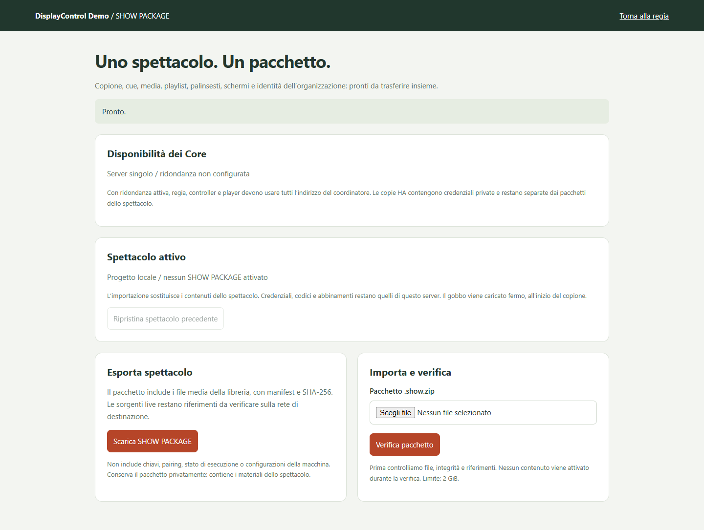

# SHOW PACKAGE

A `.show.zip` transfers the complete show: organization name/logo/colors, screen definitions, content library and media, playlists, schedules, Prompt script/cues and appearance. It uses standard ZIP and a versioned SHA-256 manifest. It is private show material, not a public release archive.

Open **SHOW PACKAGE** from the console or Prompt, or `/show.html`. Administrator credentials are required.

## Export and transfer

1. Save console changes and the Prompt script.
2. Choose **Scarica SHOW PACKAGE**. Missing/corrupt media and broken references block export.
3. Transfer the archive through a trusted private channel. Its manifest detects corruption; authenticity depends on the transfer source.
4. On the destination, choose the file and **Verifica pacchetto**. Review title, counts and warnings before activation.
5. Choose **Attiva questo spettacolo** outside performance time. The new Prompt starts in STOP at its first cue. Reload/check players, then start playback.

Activation checks both console and Prompt revisions; intervening edits cause a conflict. All project/script changes commit together. Media use content-addressed filenames; interrupted imports cannot activate a partial show. A content-only snapshot of the current show is retained for **Ripristina spettacolo precedente**. The previous-show archive is local to that machine, not a replicated HA history.

## Excluded and external resources

- Administrator/player/controller tokens, pairing codes and machine configuration stay local.
- Current scroll position, play state, blackout/messages and logical TAKE role are not transported. Import starts stopped.
- Original TXT/DOCX containers are converted to canonical script text/cues; the package carries that complete script, not the original Word document.
- Live NDI/HTTP entries remain references, not recordings. Confirm source names, networking, runtime/codecs and encoding capacity on the destination.
- HTTP URLs containing credentials or query parameters must be cleaned before export; do not embed access secrets in a show.
- Vendor binaries, fonts installed in the OS, controller drivers and APKs are not show content. Match font availability across players.

Limits: 2 GiB of content, up to 2,000 media files, bounded JSON metadata. Uploaded media retain the server's 300 MiB per-file limit. The importer rejects traversal paths, extra files, duplicate ZIP names, symlinks, encrypted entries, unsupported versions, bad hashes and dangling references. Preview expires after 30 minutes; cancellation removes its staged files. Restart discards unfinished previews.

## Server redundancy

For an independent reserve installation, import the same SHOW PACKAGE and pair that installation separately. For the configured three-node HA system, import through the coordinator: content, active runtime and cluster identities are replicated privately. Do not confuse the credential-free show archive with private HA recovery files. See [CLUSTER.md](CLUSTER.md).

API: administrator-only `GET /api/show/status`, `GET /api/show/export`, binary `POST /api/show/stage`, JSON `POST /api/show/activate`, `/discard`, `/rollback`. Activation requires the preview ticket and expected `revision`/`promptVersion`.
